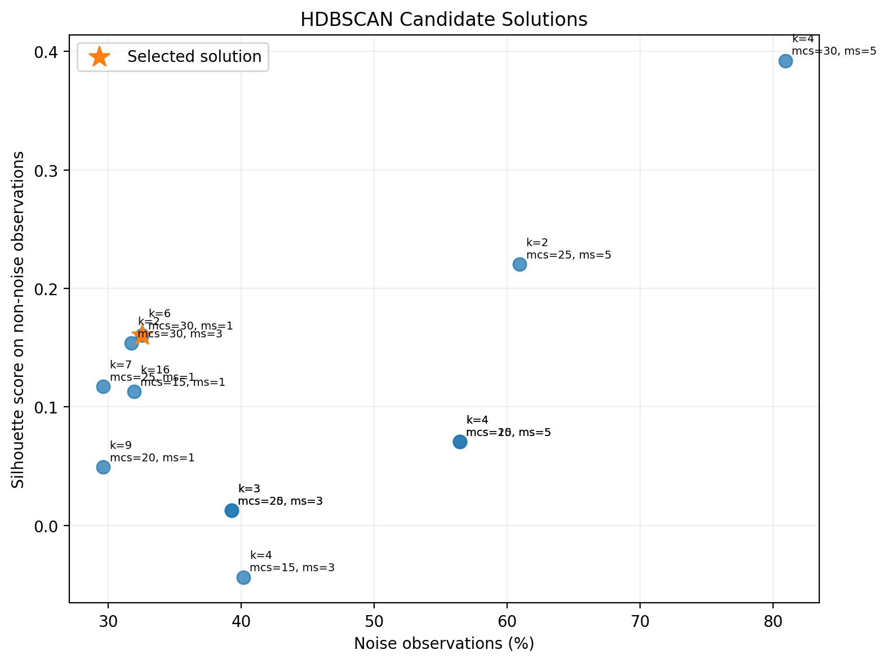
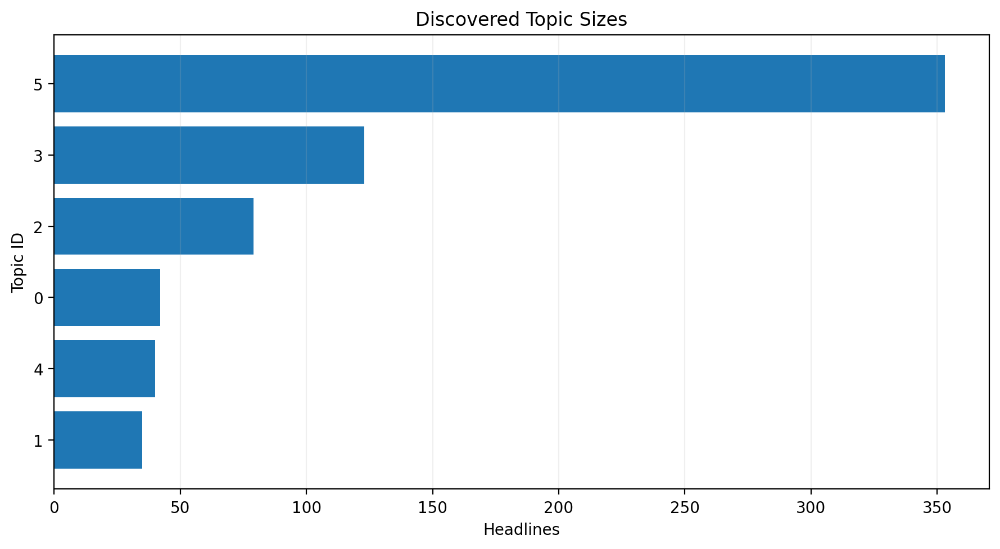
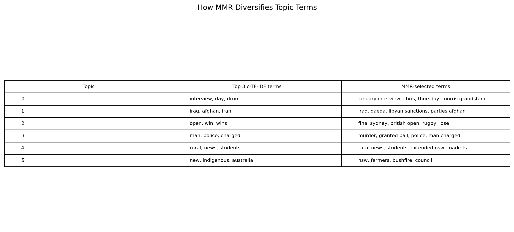
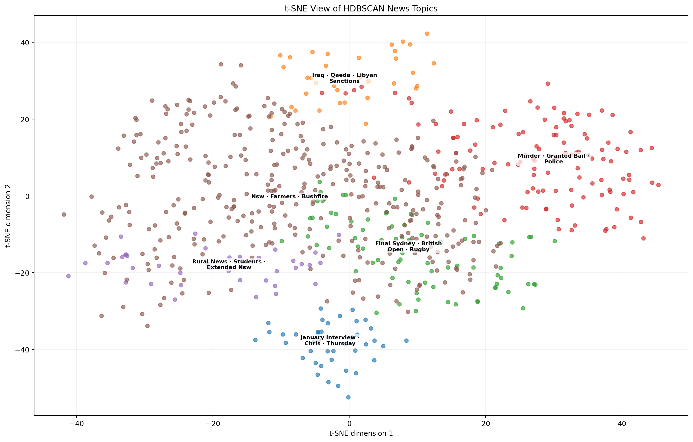
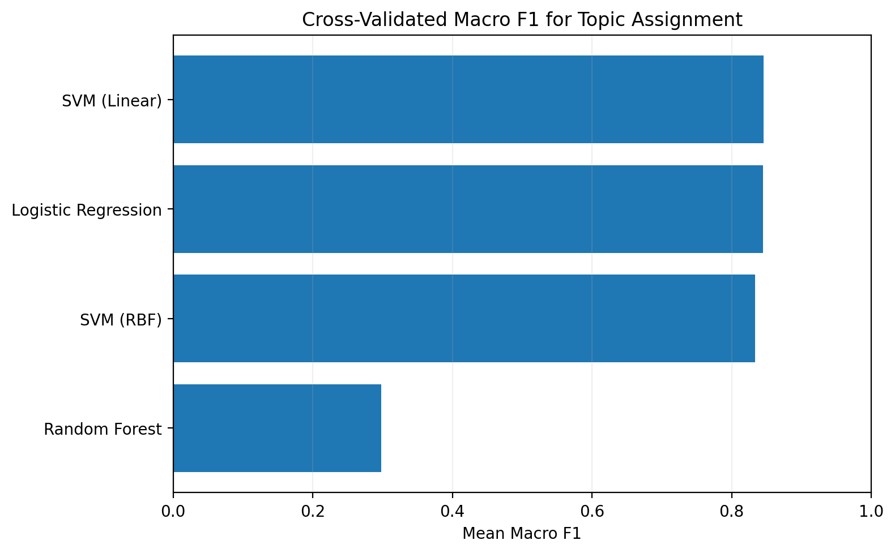

# Project Overview

News headlines are short and context-limited, so meaningful topic discovery requires more than grouping documents by repeated words. I built a **BERTopic-style semantic topic-discovery pipeline** that combines SentenceTransformer embeddings, t-SNE, HDBSCAN, c-TF-IDF, and Maximal Marginal Relevance (MMR), then trained a downstream classifier to assign new headlines to the discovered topic structure.

The final revision directly addresses the main weaknesses of the original project. Dimensionality reduction now occurs **before HDBSCAN**, MMR is used to improve automatic topic representation, and topic coherence is checked with centroid-nearest representative headlines. The revised solution reduces the original **29 fragmented clusters to 6 better-supported topics**, lowers the noise rate from **68.6% to 32.5%**, and retains **672 of 996 cleaned headlines** in discovered topics.

For downstream topic assignment, **Linear SVM** provided the strongest cross-validated Macro F1 at **0.846**, with a holdout Macro F1 of **0.869**.

## Application Demo and Live App

Watch this short demo first for a quick look at entering a headline, receiving a user-friendly topic assignment, reviewing topic keywords and related headlines, and browsing the discovered topics.

<video controls playsinline preload="metadata"
       style="display: block; width: 100%; aspect-ratio: 16 / 9; object-fit: contain; background: #000; border-radius: 8px;">
  <source src="../videos/projects/news-headline-topic-modeling/news-topic-app-demo.mp4" type="video/mp4">
  Your browser does not support embedded video. You can
  <a href="../videos/projects/news-headline-topic-modeling/news-topic-app-demo.mp4">open the demonstration video directly</a>.
</video>

::: {.callout-note title="Try the Live Application"}
The live app is designed for users and stakeholders rather than as a technical model report. Enter a headline to receive a topic assignment, or browse the discovered topics and representative headlines.

Because the application is hosted on Render's free tier, it may take approximately **1–2 minutes to start** after a period of inactivity. The embedding model is loaded only when headline analysis is first requested.

[Open Live App](https://news-topic-app.onrender.com/){.btn .btn-primary target="_blank"}

[View GitHub Project](https://github.com/hienbui0393/news-topic-app){.btn .btn-outline-secondary target="_blank"}
:::

## Application Highlights

- **Headline assignment:** Enter a new English-language headline and receive a clear topic label.
- **Related examples:** Review representative headlines from the assigned topic.
- **Topic browsing:** Explore six discovered topic groups with concise descriptions and keywords.
- **Stakeholder-focused presentation:** The live app keeps the modeling details on this project page and focuses on the user experience.

# Project Scope

| Project element | Final scope |
|:--|:--|
| Source sample | 1,000 news headlines |
| Clean modeling sample | 996 unique headlines |
| Semantic representation | SentenceTransformer `all-MiniLM-L12-v2` |
| Embedding size | 384 dimensions |
| Dimensionality reduction | 3-dimensional t-SNE before HDBSCAN |
| Topic discovery | HDBSCAN |
| Final topic count | 6 |
| Clustered headlines | 672 |
| Noise / unassigned | 324 (32.5%) |
| Topic representation | c-TF-IDF candidates + MMR |
| Topic validation | Centroid-nearest representative headlines |
| Downstream assignment | Linear SVM on original semantic embeddings |
| Live inference | ONNX-optimized MiniLM + trained Linear SVM |
| Purpose | Exploratory topic discovery and interactive topic assignment |

# Data and Topic-Discovery Design

## Data Source and Preparation

The project uses a **1,000-headline sample** from the *A Million News Headlines* dataset, sourced from **ABC News via Kaggle**. After whitespace cleaning and duplicate removal, **996 unique headlines** remain for modeling.

[View data source on Kaggle](https://www.kaggle.com/datasets/therohk/million-headlines){target="_blank"}

Duplicate removal is especially important for density-based clustering because repeated headlines can artificially increase local density without adding new semantic information.

## Final Modeling Workflow

The revised workflow is:

**SentenceTransformer embeddings → t-SNE → HDBSCAN → c-TF-IDF → MMR → centroid-based topic inspection → downstream classifier**

The key methodological change is moving t-SNE **before HDBSCAN**. The original 384-dimensional embedding space was too sparse for effective density estimation, contributing to many small clusters. Reducing the embeddings to three dimensions first gives HDBSCAN a more useful local neighborhood structure.

# HDBSCAN Model Selection

I compared a small, interpretable grid of `min_cluster_size` and `min_samples` values rather than accepting one HDBSCAN configuration without evaluation. Candidate solutions were compared using topic count, noise rate, silhouette score, and cluster support.

The selected configuration uses **`min_cluster_size = 30`** and **`min_samples = 1`**, producing **6 topics**, **32.5% noise**, and a silhouette score of **0.161**.

{fig-alt="Scatter plot comparing HDBSCAN candidate solutions by noise percentage and silhouette score, with the selected six-topic solution highlighted." fig-align="center" width="90%"}

Some candidates achieved a higher silhouette only by labeling most observations as noise. The selected solution provides a more useful balance: it retains **672 headlines** while producing larger, more trainable topic groups.

## Topic Support

{fig-alt="Horizontal bar chart showing the number of headlines assigned to each of the six discovered HDBSCAN topics." fig-align="center" width="88%"}

The smallest final topic contains **35 headlines**, a substantial improvement over the very small classes in the original 29-topic solution. The distribution remains uneven, however: the largest regional-news cluster contains **353 headlines**, so it is interpreted as a broader exploratory grouping rather than a narrowly defined category.

# Topic Representation and Interpretation

## c-TF-IDF and MMR

c-TF-IDF identifies terms that are characteristic of each discovered cluster. MMR then selects a smaller set that balances **relevance to the topic** with **diversity from terms already selected**, reducing repetitive automatic labels.

{fig-alt="Comparison showing the top c-TF-IDF candidate terms and the more diverse terms selected with Maximal Marginal Relevance." fig-align="center" width="95%"}

MMR improves interpretability without replacing c-TF-IDF. For example, the crime cluster expands from generic high-frequency terms to a more specific representation including *murder*, *granted bail*, *police*, and *man charged*.

## Final Topic Review

For each topic, I calculated a centroid in the original semantic embedding space and selected the five headlines with the highest cosine similarity to that centroid. This makes the qualitative review more representative than simply displaying the first records in dataset order.

| Topic | Portfolio label | Automatic MMR representation | Size | Representative headline |
|--:|:--|:--|--:|:--|
| 0 | Interviews & Program Segments | January Interview · Chris · Thursday | 42 | the drum monday 3 june |
| 1 | International Conflict | Iraq · Qaeda · Libyan Sanctions | 35 | al qaeda claims wave of baghdad attacks |
| 2 | Sports | Final Sydney · British Open · Rugby | 79 | young wallabies finish fourth |
| 3 | Crime & Courts | Murder · Granted Bail · Police | 123 | mps killer ordered to face supreme court |
| 4 | Regional Education & Community | Rural News · Students · Extended Nsw | 40 | rural qld teacher rego |
| 5 | Regional Australia & Current Affairs | Nsw · Farmers · Bushfire | 353 | qld flood victims donate to vic bushfire appeal |

The portfolio labels above are reader-friendly descriptions for presentation. The clustering model, classifier targets, MMR terms, and representative-headline selections remain unchanged.

# Topic Map

The first two t-SNE dimensions provide a compact visual diagnostic of the discovered structure.

{fig-alt="Two-dimensional t-SNE map of clustered news headlines with automatic MMR-based labels displayed at the HDBSCAN cluster centers." fig-align="center" width="95%"}

Several groups form visibly concentrated regions, particularly the international-conflict, crime, sports, and interview/program topics. The large regional-news cluster is more diffuse, which agrees with the representative-headline review and supports treating it as a broader grouping.

# Downstream Topic Assignment

The topic IDs discovered by HDBSCAN are **pseudo-labels**, not independently human-labeled news categories. I therefore treat the supervised models as a downstream diagnostic: they measure how consistently the discovered topic structure can be reproduced from the original 384-dimensional semantic embeddings.

I compared Logistic Regression, Random Forest, Linear SVM, and RBF SVM using stratified holdout evaluation and stratified cross-validation.

{fig-alt="Horizontal bar chart comparing cross-validated Macro F1 for Logistic Regression, Random Forest, Linear SVM, and RBF SVM." fig-align="center" width="88%"}

| Model | Holdout Accuracy | Holdout Macro F1 | CV Macro F1 |
|:--|--:|--:|--:|
| SVM (Linear) | 0.881 | 0.869 | 0.846 |
| Logistic Regression | 0.867 | 0.844 | 0.845 |
| SVM (RBF) | 0.889 | 0.875 | 0.833 |
| Random Forest | 0.607 | 0.300 | 0.298 |

**Linear SVM** was selected because it achieved the best cross-validated Macro F1 (**0.846**), narrowly ahead of Logistic Regression (**0.845**). RBF SVM produced the strongest single holdout Macro F1 (**0.875**) but lower cross-validated performance, making Linear SVM the more stable choice for the live application.

## Live Assignment Design

The live application does **not** attempt to send a new headline through t-SNE. Scikit-learn t-SNE does not provide a stable out-of-sample `transform()`.

Instead, new headlines follow this deployment path:

**New headline → ONNX-optimized MiniLM embedding → trained Linear SVM → assigned discovered topic**

The notebook uses SentenceTransformer `all-MiniLM-L12-v2` embeddings for model development and evaluation. For deployment, the live application uses an ONNX-optimized version of the same MiniLM model for memory-efficient live inference.

This separates corpus-level topic discovery from live inference: t-SNE + HDBSCAN are used to discover the topic structure, while the trained Linear SVM assigns new headlines to that structure.

# Technologies

- **NLP:** SentenceTransformers
- **Dimensionality reduction:** t-SNE
- **Clustering:** HDBSCAN
- **Topic representation:** CountVectorizer, c-TF-IDF, Maximal Marginal Relevance
- **Classification:** Logistic Regression, Random Forest, Linear SVM, RBF SVM
- **Evaluation:** Silhouette score, topic support, Accuracy, Macro F1, stratified cross-validation
- **Application:** Streamlit, Joblib
- **Deployment inference:** ONNX Runtime, LightEmbed
- **Deployment and reproducibility:** Render, Git, GitHub, Google Colab, Quarto

# Limitations and Next Steps

The discovered topics are exploratory groups rather than independently verified categories. The largest cluster remains broad, and the automatic MMR labels are descriptive summaries rather than ground-truth topic names.

t-SNE is useful for corpus-level discovery but does not provide a standard out-of-sample transform for new observations. The live application therefore relies on the trained Linear SVM to reproduce the discovered topic structure from the original semantic embeddings.

A production news-classification system would require independently defined categories, a substantially larger and more current labeled corpus, external validation, model monitoring, and a clearer policy for headlines that do not fit an existing topic.

# Final Takeaway

This project demonstrates a complete NLP workflow from semantic representation and density-based topic discovery to interpretable topic descriptions and a deployed user-facing application. The revision materially improved the original project by reducing fragmentation, adding MMR, strengthening topic-coherence review, and selecting a stable Linear SVM for live headline assignment.
