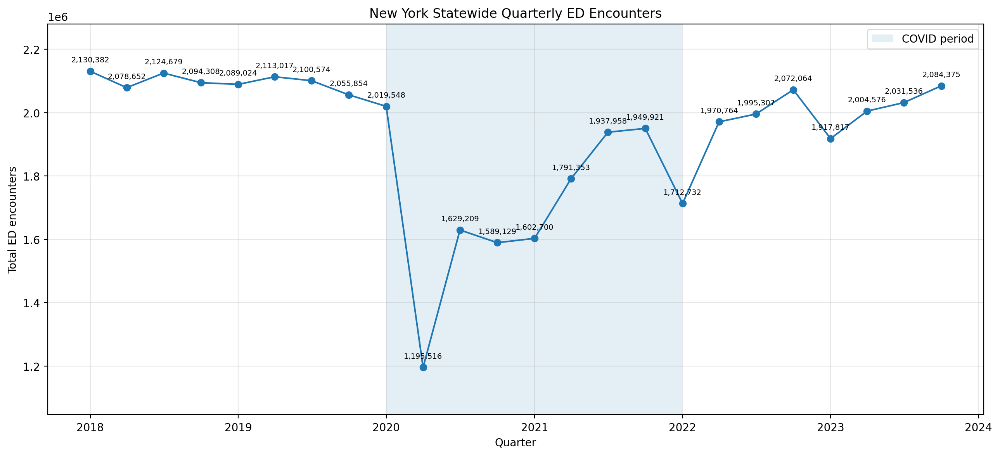
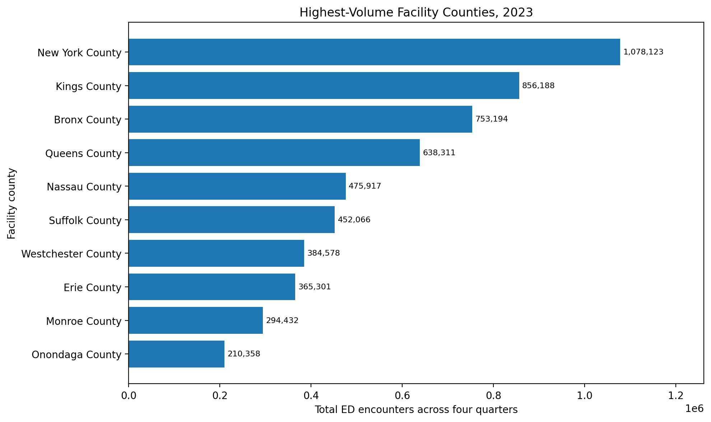
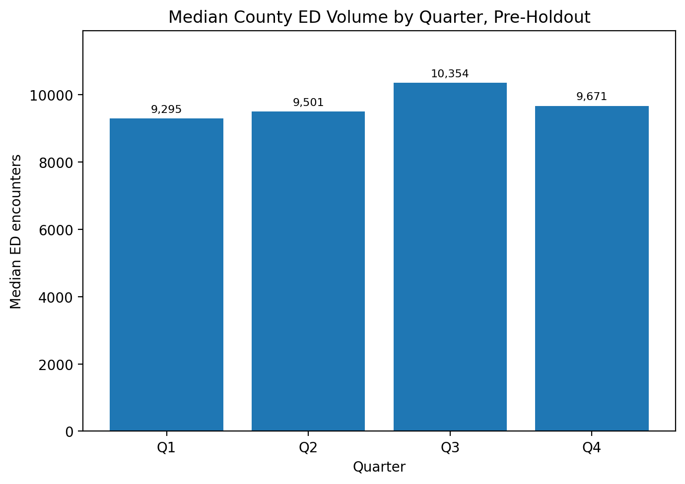
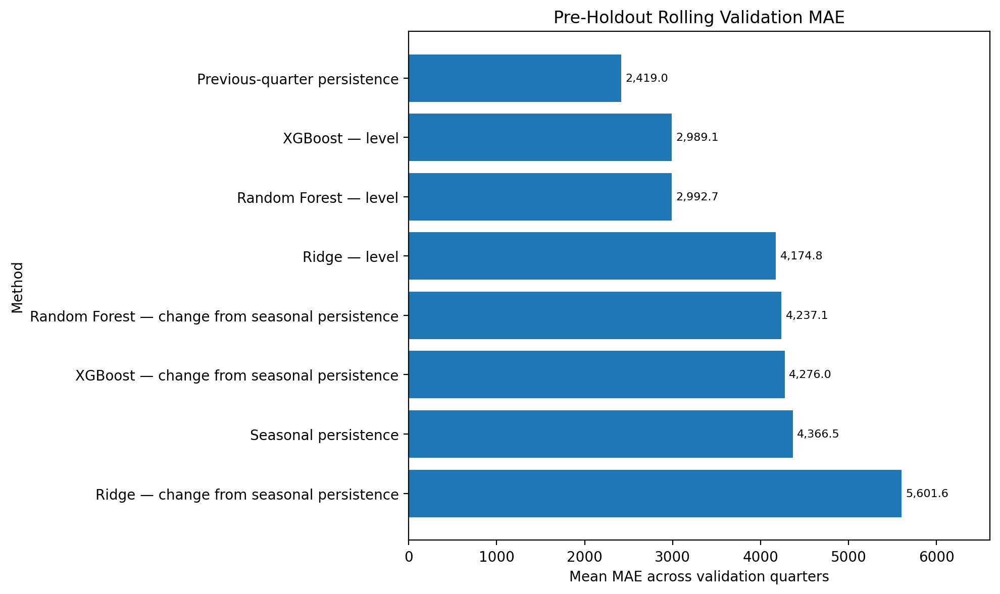
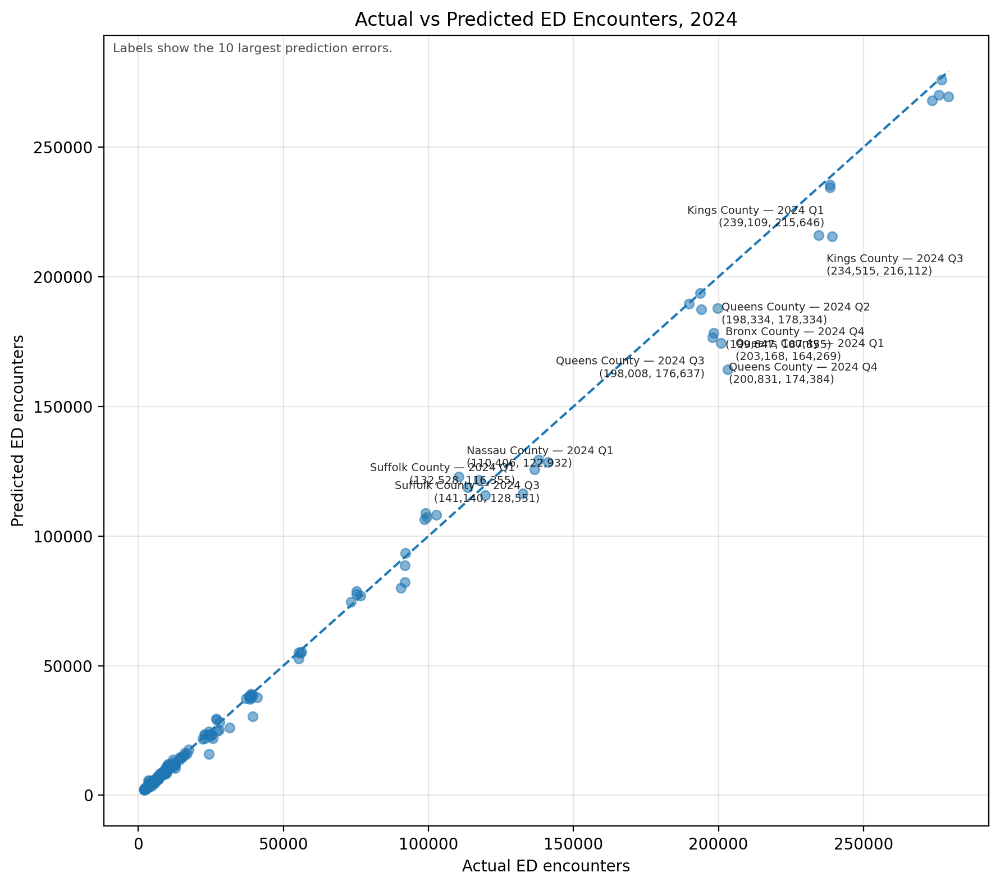
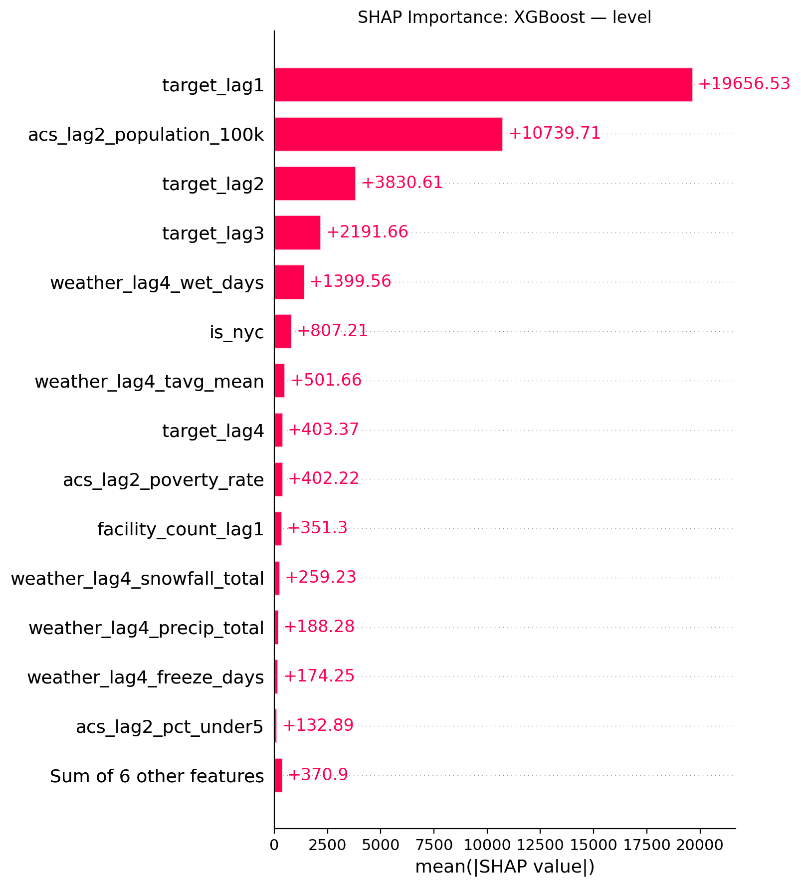

# Project Overview

Emergency departments need reliable demand estimates to support staffing and capacity-planning discussions. For my DATA 975 capstone, I built an end-to-end analytics workflow for total emergency department encounters by **New York facility county and quarter**, combining **Oracle SQL, Python machine learning, Power BI, and a deployed Flask application**.

The analysis contains **1,536 county-quarter observations** spanning **57 facility counties** and **28 quarters from 2018 Q1 through 2024 Q4**. I evaluated machine-learning models against transparent forecasting benchmarks using chronological validation and a locked 2024 holdout.

The key result was that **previous-quarter persistence outperformed tuned XGBoost and seasonal persistence**. It achieved a 2024 holdout MAE of **1,253 encounters** and WAPE of **3.36%**, compared with **2,144 MAE** and **5.75% WAPE** for tuned XGBoost. The application therefore uses persistence for its one-quarter-ahead prototype and retains XGBoost for historical evaluation and diagnostics.

## End-to-End Workflow

```text
Public data sources
        ↓
Oracle SQL
staging → cleaning → joins → lag features → analytical county-quarter table
        ↓
Python
validation → benchmark comparison → XGBoost tuning → holdout evaluation
        ↓
Power BI                     Flask
BI reporting                 forecasting prototype
        ↓                         ↓
Portfolio dashboard          live deployed application
```

This separation keeps stable data preparation in SQL, model development in Python, and interactive reporting in Power BI.

# Application Demo and Live App

Watch this short demo for a quick look at county and period selection, forecast generation, historical comparison, multi-county evaluation, and result interpretation.

<div style="max-width: 760px; margin: 0 auto 1.5rem auto;">

<video controls playsinline preload="metadata"
       style="display: block; width: 100%; aspect-ratio: 16 / 9; object-fit: contain; background: #000; border-radius: 8px;">
  <source src="../videos/projects/ed-demand/ed-demand-app-demo.mp4" type="video/mp4">
  Your browser does not support embedded video. You can
  <a href="../videos/projects/ed-demand/ed-demand-app-demo.mp4">open the demonstration video directly</a>.
</video>

</div>

::: {.callout-note title="Try the Live Application"}
Want to explore the forecasting prototype yourself? Because it is hosted on Render, it may take approximately **1–2 minutes to start** after a period of inactivity.

[Open Live App](https://ny-quarterly-ed-demand-app.onrender.com/){.btn .btn-primary target="_blank"}

[View Presentation](../files/ED_Demand_ThiThanhHienBui_Emi_Final.pdf){.btn .btn-outline-secondary target="_blank"}
:::

## Application Highlights

- **Prototype forecast:** Generate a one-quarter-ahead estimate using the recommended persistence method.
- **Historical result:** Compare observed demand with XGBoost and both persistence benchmarks.
- **Multi-county evaluation:** Compare XGBoost and previous-quarter persistence across two to ten selected counties.
- **Clear interpretation:** Distinguish retrospective evaluation from a live current-quarter forecast.

# Power BI Analytics Dashboard

I also built a three-page Power BI report to translate the analytical dataset and model evaluation into a stakeholder-facing BI experience.

The report includes:

- **Executive Overview:** statewide KPIs, quarterly demand trend, county map, Top 10 counties by ED encounters per 100K, regional comparison, and counties with the largest quarter-over-quarter increases.
- **County Analysis:** county and snapshot-period selection, historical demand trend, demographic context, lagged weather context, and comparison with regional and statewide benchmarks.
- **Forecast & Planning:** recommended forecasting method, holdout performance, actual-versus-forecast comparison, quarterly MAE, method comparison, and largest XGBoost errors.

## Power BI Demo

Watch this short demo to see the report navigation, slicers, cross-filtering, county map, benchmark comparisons, and 2024 holdout evaluation in action.

<div style="max-width: 900px; margin: 0 auto 1.5rem auto;">

<video controls playsinline preload="metadata"
       style="display: block; width: 100%; aspect-ratio: 16 / 9; object-fit: contain; background: #000; border-radius: 8px;">
  <source src="../videos/projects/ed-demand/ed-demand-powerbi-demo.mp4" type="video/mp4">
  Your browser does not support embedded video. You can
  <a href="../videos/projects/ed-demand/ed-demand-powerbi-demo.mp4">open the Power BI demonstration video directly</a>.
</video>

</div>

::: {.callout-tip title="View the Power BI Dashboard"}
The portfolio version is shared as a **PDF export** of the Power BI report. The original `.pbix` contains interactive page navigation, slicers, tooltips, cross-filtering, and map interactions; those interactions are not preserved in PDF.

[View Power BI Dashboard (PDF)](../files/ED_Demand_PowerBI_Dashboard.pdf){.btn .btn-primary target="_blank"}
:::

# Project Scope

| Project element | Final scope |
|:--|:--|
| Unit of analysis | One New York facility county-quarter |
| Target | Total ED encounters |
| Full analysis period | 2018 Q1–2024 Q4 |
| Deployed model-ready panel | 2019 Q1–2024 Q4 |
| Coverage | 1,536 county-quarter observations spanning 57 facility counties |
| Final holdout | 2024 Q1–Q4 |
| Selected ML model | Tuned XGBoost — level |
| Recommended method | Previous-quarter persistence |
| Purpose | Retrospective public-data planning prototype |

::: {.callout-important}
**Facility county is not necessarily the patient's county of residence.** The target represents encounters reported by facilities located within a county, so this project supports facility-location planning rather than resident-level utilization analysis.
:::

# Exploratory Insights

## Statewide Demand Through the COVID Disruption

Quarterly statewide encounters were relatively stable near 2.1 million before 2020, then fell sharply to about 1.19 million in 2020 Q2. Volume recovered gradually and reached about 2.08 million by 2023 Q4, showing why chronological validation and explicit COVID-period handling were necessary.

{fig-alt="Line chart of statewide quarterly emergency department encounters showing a sharp decline in 2020 and recovery through 2023." fig-align="center" width="95%"}

## County Concentration and Seasonality

New York, Kings, and Bronx were the three highest-volume facility counties in 2023, so statewide totals are strongly influenced by a small number of large counties. Median county volume also shows a modest Q3 peak, but this seasonal pattern was not strong enough for seasonal persistence to outperform the previous-quarter benchmark.

::: {layout-ncol=2}
{fig-alt="Horizontal bar chart showing New York, Kings, and Bronx as the highest-volume facility counties in 2023."}

{fig-alt="Bar chart showing the highest pre-holdout median county emergency department volume in quarter three."}
:::

# Data and Forecast Design

## Data Sources

| Source | Contribution |
|:--|:--|
| SPARCS ED Encounters by Facility | Quarterly encounter target aggregated by facility county |
| U.S. Census ACS 5-Year Estimates | Lagged population, income, poverty, and age predictors |
| Open-Meteo Historical Weather | Daily weather aggregated into lagged quarterly conditions |
| U.S. Census Gazetteer | Location and regional indicators |

Exploratory analysis identified a major COVID-era break, recovery in later quarters, concentration in high-volume counties, and a seasonal peak in median Q3 demand. These findings supported chronological evaluation rather than a random train-test split.

## SQL Analytical Layer

The original analysis pipeline was refactored so that reusable data preparation happens in **Oracle SQL** before modeling and reporting.

The SQL layer:

- stages and cleans the source tables;
- joins ED, geography, ACS, and weather data;
- enforces a county-quarter analytical grain;
- creates exact quarter lags and lagged contextual features;
- calculates reusable QoQ, YoY, regional, and per-100K fields; and
- exports the final analytical dataset used by Python and Power BI.

This design separates **data engineering and business logic** from model development and dashboard presentation.

## Leakage-Safe Features

I screened 25 candidate predictors and selected 20 using pre-holdout validation. The selected feature set included:

- demand history from the previous one to four quarters;
- lagged facility count;
- lagged demographic and socioeconomic context;
- lagged precipitation, snow, hot-day, wet-day, and freeze-day measures; and
- geographic and regional indicators.

Expanding training windows used only information available before each forecast quarter. Feature selection and model tuning were completed before the full 2024 holdout was evaluated. Recent demand—especially the previous quarter—was the strongest signal in the XGBoost diagnostics.

# Model Evaluation

## Pre-Holdout Model Selection

Previous-quarter persistence achieved the lowest mean rolling-validation MAE at **2,419 encounters**. Among the machine-learning candidates, XGBoost had the lowest mean rolling-origin MAE at **2,991.4**, narrowly ahead of Random Forest at **2,992.7**. This selection identified the strongest ML candidate under the common validation design, but it did not imply that ML beat persistence overall.

{fig-alt="Horizontal bar chart showing previous-quarter persistence with the lowest mean rolling-validation MAE." fig-align="center" width="90%"}

## Final 2024 Holdout

| Method | MAE | WAPE | R-squared | Skill |
|:--|--:|--:|--:|--:|
| **Previous-quarter persistence** | **1,253** | **3.36%** | **0.9970** | **0.00** |
| Tuned XGBoost — level | 2,144 | 5.75% | 0.9930 | -0.71 |
| Same-quarter previous-year persistence | 2,841 | 7.61% | 0.9846 | -1.27 |

**MAE** is the average absolute miss in encounter units. **WAPE** expresses total absolute error as a percentage of total observed volume. **Skill** is measured against previous-quarter persistence: positive skill means the competing method reduces MAE relative to the benchmark, while negative skill means it performs worse.

The tuned XGBoost model did **not** beat previous-quarter persistence on the final holdout. This is an important modeling result: the strongest evaluated method was also transparent, inexpensive, and easy for stakeholders to audit.

## XGBoost Diagnostic Views

The 2024 actual-versus-predicted points mostly follow the diagonal, confirming that XGBoost captured the large differences in scale across counties. Its largest misses occurred among high-volume observations, which is why a high R-squared did not translate into the lowest MAE or WAPE.

{fig-alt="Scatter plot of actual versus predicted 2024 emergency department encounters with most points near the diagonal and several larger high-volume errors." fig-align="center" width="90%"}

SHAP analysis shows that the previous quarter's encounter volume was the dominant XGBoost signal, followed by lagged population and older demand lags. Weather and socioeconomic features contributed less, reinforcing the practical strength of the simple persistence benchmark.

{fig-alt="SHAP importance chart showing previous-quarter demand as the strongest XGBoost feature, followed by lagged population and earlier demand lags." fig-align="center" width="90%"}

# Technologies

- **Data engineering and SQL:** Oracle Database Free, SQL Developer, Oracle SQL
- **Analysis and machine learning:** Python, Pandas, NumPy, Scikit-learn, XGBoost, SHAP
- **Business intelligence:** Power BI, DAX
- **Application:** Flask, HTML/CSS, Joblib
- **Deployment and reproducibility:** Render, Git, GitHub, Quarto, automated smoke testing

# Limitations and Next Steps

This is a retrospective prototype built from public quarterly data, not a live hospital operations system. Public suppression may understate totals in affected facility county-quarters, and quarterly aggregation cannot represent daily or hourly arrival peaks. The final holdout covers only one complete calendar year. The data also lacks patient acuity, staffed beds, shift coverage, and other hospital-specific constraints.

A production version would require a current internal encounter feed, automated predictor refreshes, performance monitoring, access controls, and stakeholder governance. Hospital-level staffing, capacity, acuity, and arrival-pattern data would be necessary before translating demand forecasts into operational staffing recommendations.

# Final Takeaway

This project demonstrates an end-to-end analytics workflow from **public-data integration and Oracle SQL transformation** through **leakage-safe forecasting, Power BI reporting, and Flask deployment**.

The final recommendation is deliberately evidence-based: **use previous-quarter persistence for the prototype forecast and retain XGBoost for historical evaluation and diagnostics**. The simpler benchmark achieved the best out-of-time holdout performance, showing why transparent baselines should remain central to practical forecasting work.
