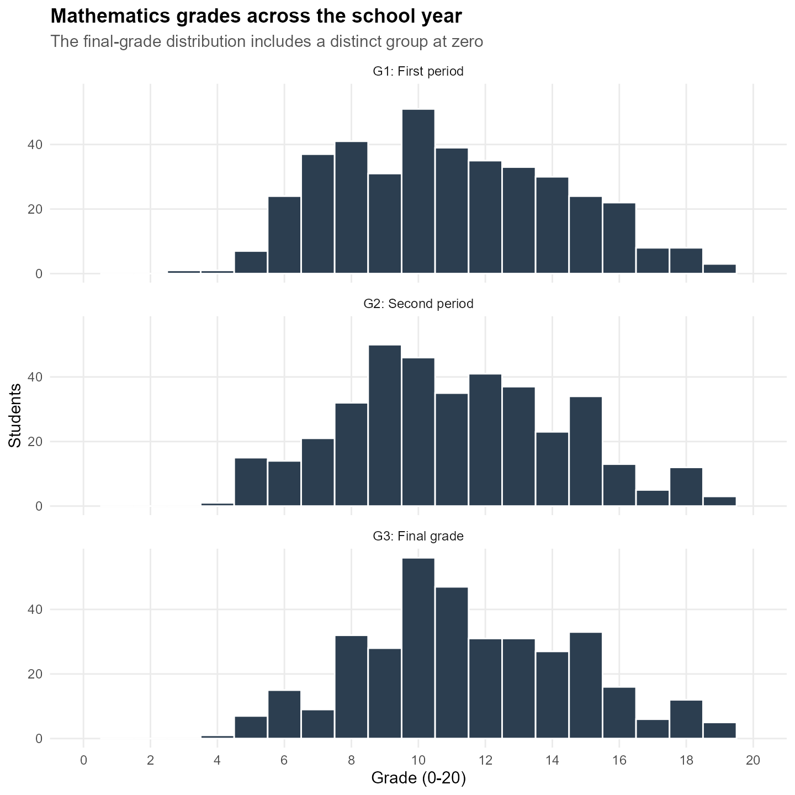
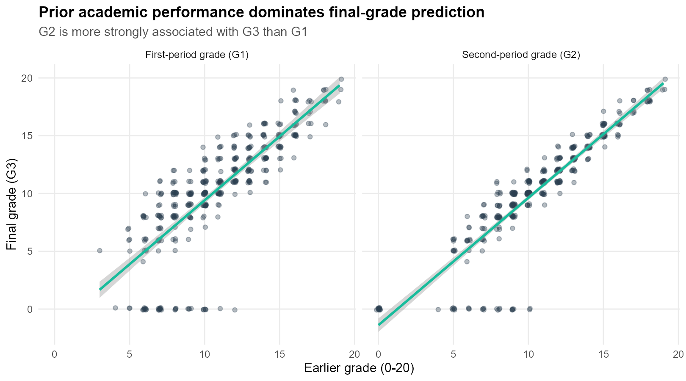
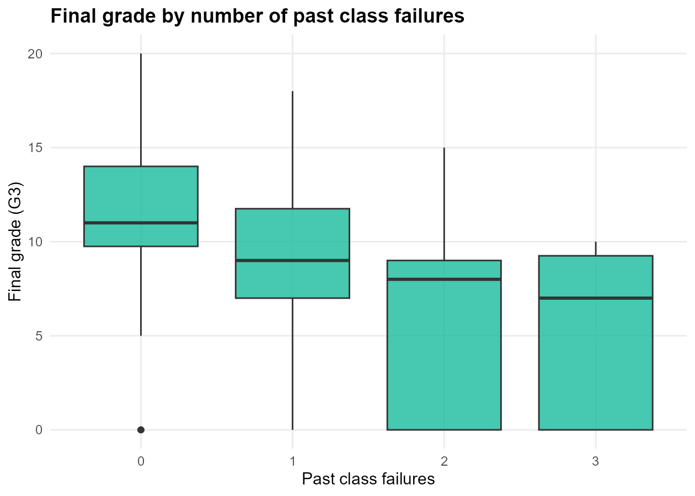
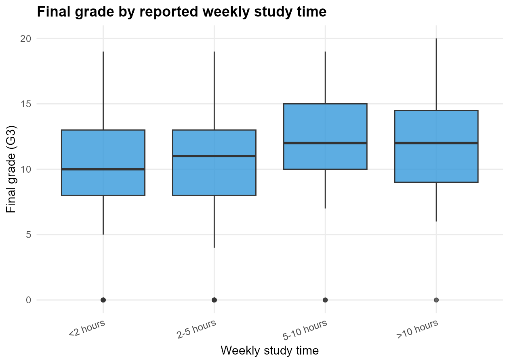
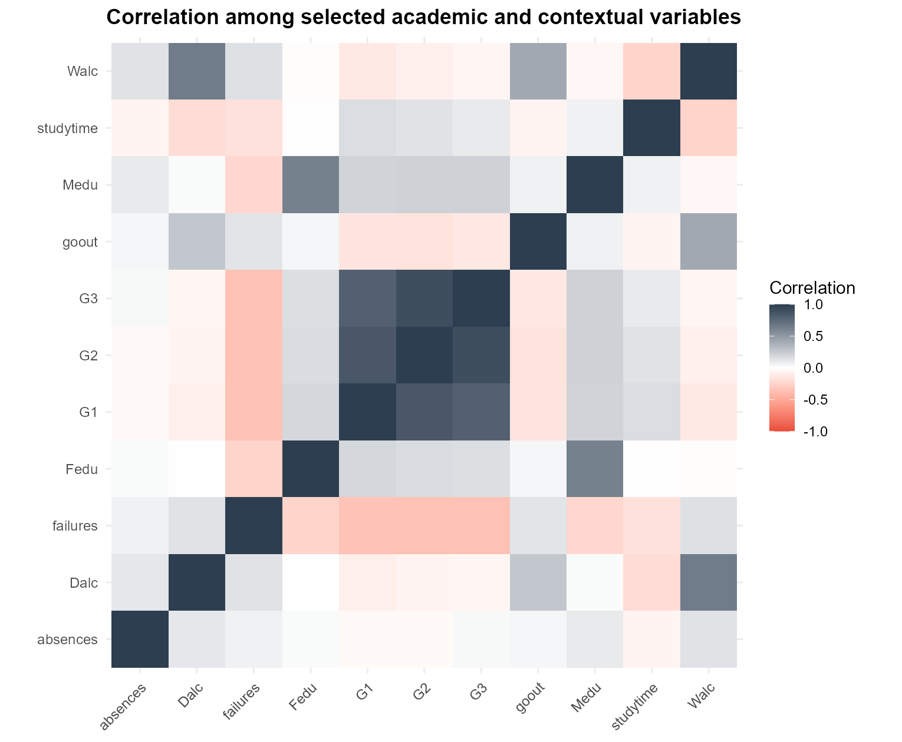
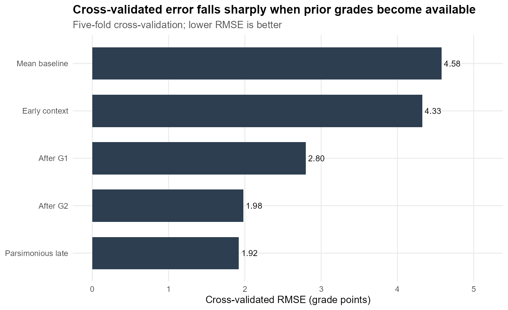
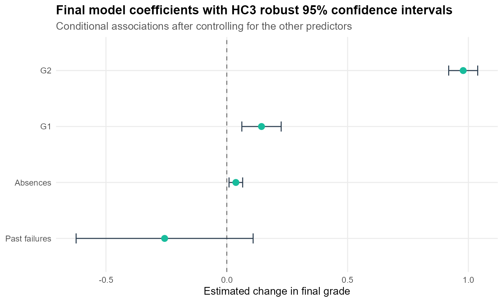
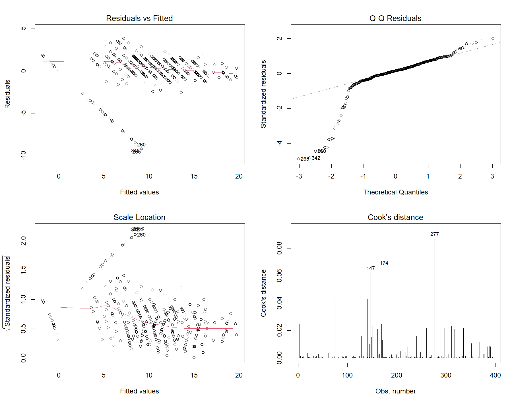

# Question

This project revisits my statistics-in-R coursework as a more rigorous portfolio analysis of student mathematics performance. The goal is not only to fit a regression model, but to distinguish between **early prediction**, **late prediction**, **statistical inference**, and **model diagnostics**.

The analysis asks three questions:

1. **Association:** Which academic and contextual variables are most strongly associated with students' final mathematics grade (`G3`)?
2. **Prediction timing:** How much predictive performance is gained when first-period (`G1`) and second-period (`G2`) grades become available?
3. **Robustness:** Do the main conclusions remain reasonable after checking regression assumptions, influential observations, and the unusual zero-grade pattern?

The distinction between early and late prediction is important. Demographic and behavioral information is available earlier in the school year, while `G1` and `G2` can provide more accurate predictions but only after substantial academic performance has already been observed.

# Data

The analysis uses the **Mathematics** file from the UCI Student Performance dataset. It contains **395 students and 33 raw variables** from two Portuguese secondary schools. The outcome, `G3`, is the final mathematics grade on a 0-20 scale.

| Data element | Scope |
|:--|:--|
| Unit of analysis | One student |
| Subject | Mathematics |
| Observations | 395 students |
| Raw variables | 33 |
| Target | Final mathematics grade (`G3`, 0-20) |
| Earlier academic outcomes | `G1`, `G2` |
| Contextual variables used | Failures, absences, study time, higher-education intent, parental education, going-out frequency, school |
| Missing values in raw file | 0 |

**Source:** Cortez, P. (2008), *Student Performance*, UCI Machine Learning Repository.

## Data-quality audit

A notable pattern appears in the final-grade variable: **38 students (9.6%) have `G3 = 0`, and all 38 also have zero recorded absences**.

| Audit item | Result |
|:--|--:|
| Total students | 395 |
| Students with `G3 = 0` | 38 |
| Percent with `G3 = 0` | 9.6% |
| `G3 = 0` students with zero absences | 38 |
| Mean absences among `G3 = 0` students | 0.00 |
| Mean absences among `G3 > 0` students | 6.32 |

::: {.callout-important}
The dataset does not document the reason for this zero-grade/zero-absence pattern. I therefore keep all valid records in the primary analysis but repeat the final model on students with `G3 > 0` as a sensitivity check.
:::

# EDA

## Grade distributions

| Grade | N | Mean | SD | Q1 | Median | Q3 | Min | Max |
|:--|--:|--:|--:|--:|--:|--:|--:|--:|
| G1 | 395 | 10.9 | 3.32 | 8 | 11 | 13 | 3 | 19 |
| G2 | 395 | 10.7 | 3.76 | 9 | 11 | 13 | 0 | 19 |
| G3 | 395 | 10.4 | 4.58 | 8 | 11 | 14 | 0 | 20 |

{fig-alt="Three histograms showing G1, G2, and G3 mathematics grade distributions. G3 contains a visible group of zero grades." fig-align="center" width="88%"}

Average grades are similar across assessment periods, but the final grade has the largest variability. The mass at `G3 = 0` is especially important because it affects the residual distribution and the estimated absence coefficient.

## Prior grades and final performance

{fig-alt="Two scatter plots comparing G1 and G2 with G3. Both are positively associated with final grade, with G2 showing the tighter relationship." fig-align="center" width="92%"}

The strongest bivariate relationships are academic:

- Correlation between `G1` and `G3`: **0.801**
- Correlation between `G2` and `G3`: **0.905**

`G2` is therefore expected to dominate late-stage prediction because it is both strongly related to the final grade and measured closest to the final assessment.

## Contextual patterns

::: {layout-ncol=2}

{fig-alt="Box plots showing lower final mathematics grades among students with more past class failures."}

{fig-alt="Box plots comparing final grade across four reported weekly study-time categories."}

:::

Past failures have a clear negative raw association with final performance. Study time shows a weaker pattern and is not strictly monotonic across the four categories, so I treat it as a contextual predictor rather than assuming a strong linear effect.

## Correlation overview

{fig-alt="Correlation heatmap for selected grades, failures, absences, study time, parental education, social behavior, and alcohol-use variables." fig-align="center" width="82%"}

The heatmap reinforces the main EDA conclusion: previous grades contain much more direct information about `G3` than most demographic, family, or lifestyle variables.

# Statistical Methods

I use ordinary least squares regression because `G3` is a numeric 0-20 outcome and the primary statistical goal is to quantify interpretable **conditional associations**. The analysis is observational, so regression coefficients are not interpreted as causal effects.

Rather than allowing stepwise AIC to define the analysis, I compare five **pre-specified models based on when information becomes available**.

| Model | Information available | Predictors |
|:--|:--|:--|
| Mean baseline | No predictors | Intercept only |
| Early context | Before period grades | Failures, absences, study time, higher-education intent, parental education, going-out frequency, school |
| After G1 | After first period | Early-context variables + `G1` |
| After G2 | After second period | Early-context variables + `G1` + `G2` |
| Parsimonious late | Late-stage compact model | `G1`, `G2`, absences, failures |

Model performance is evaluated with **5-fold cross-validation** using a fixed random seed. The `G3 = 0` records are distributed across folds so the unusual zero-grade pattern is represented throughout validation.

I report:

- **Adjusted R-squared** for in-sample explanatory fit
- **AIC** for relative in-sample model comparison
- **Cross-validated RMSE** for typical prediction error in grade points
- **Cross-validated MAE** for average absolute prediction error
- **Cross-validated R-squared** for out-of-fold predictive performance

For coefficient inference, I use **HC3 heteroscedasticity-robust standard errors and 95% confidence intervals** because the residual diagnostics indicate non-constant variance.

# Model Comparison

| Model | Adjusted R² | AIC | CV RMSE | CV MAE | CV R² |
|:--|--:|--:|--:|--:|--:|
| Mean baseline | 0.000 | 2326 | 4.58 | 3.43 | -0.001 |
| Early context | 0.148 | 2271 | 4.33 | 3.32 | 0.106 |
| After G1 | 0.651 | 1919 | 2.80 | 2.00 | 0.626 |
| After G2 | 0.825 | 1647 | 1.98 | 1.23 | 0.813 |
| **Parsimonious late** | **0.826** | **1640** | **1.92** | **1.16** | **0.824** |

{fig-alt="Horizontal bar chart showing cross-validated RMSE decreasing from the mean baseline and early-context models to the G1, G2, and parsimonious late models." fig-align="center" width="90%"}

The comparison makes the timing trade-off clear. Contextual variables alone provide limited predictive information: the early model reaches only **CV R² = 0.106**. After `G1` becomes available, CV R² increases to **0.626**; after `G2`, it rises to **0.813**.

The compact late-stage model performs best among the candidates, reaching:

- **CV RMSE: 1.92 grade points**
- **CV MAE: 1.16 grade points**
- **CV R²: 0.824**
- **Adjusted R²: 0.826**

It also uses only four predictors, making it easier to interpret than the larger late-stage model.

## Final model

The selected interpretive model is:

$$
G3 = \beta_0 + \beta_1 G1 + \beta_2 G2 +
\beta_3 \text{Absences} + \beta_4 \text{Failures} + \epsilon
$$

### HC3 robust coefficient estimates

| Term | Estimate | HC3 SE | p-value | 95% CI |
|:--|--:|--:|--:|:--|
| Intercept | -1.765 | 0.430 | <0.001 | [-2.610, -0.919] |
| G1 | 0.144 | 0.041 | <0.001 | [0.062, 0.225] |
| **G2** | **0.978** | **0.031** | **<0.001** | **[0.918, 1.038]** |
| Absences | 0.038 | 0.014 | 0.009 | [0.009, 0.066] |
| Failures | -0.257 | 0.186 | 0.168 | [-0.623, 0.109] |

{fig-alt="Coefficient plot for G1, G2, absences, and failures with HC3 robust 95 percent confidence intervals." fig-align="center" width="86%"}

`G2` is the dominant conditional predictor. Holding `G1`, absences, and failures constant, a one-point increase in `G2` is associated with approximately a **0.98-point increase in `G3`**.

`G1` also adds independent information after `G2` is controlled for. In contrast, the failures coefficient is negative but **not statistically significant under HC3 robust inference** (`p = 0.168`), so the analysis does not claim an independent failures effect after prior grades are included.

# Diagnostics

## Standard diagnostic plots

{fig-alt="Four standard linear-regression diagnostic plots for the final student performance model." fig-align="center" width="92%"}

The diagnostic plots reveal two important issues:

1. The zero-grade observations create a heavy lower residual tail, so residual normality is imperfect.
2. Residual spread is not constant across fitted values, motivating robust standard errors.

## Heteroscedasticity and multicollinearity

| Diagnostic | Result | Interpretation |
|:--|:--|:--|
| Breusch-Pagan-style statistic | 27.079, df = 4 | Evidence of non-constant residual variance |
| Breusch-Pagan-style p-value | <0.001 | Use robust inference |
| Maximum VIF | 3.70 | Moderate, not extreme |
| Cook's distance threshold | 0.0101 (`4/n`) | Screening threshold only |
| Observations above Cook's threshold | 31 | Review rather than automatically delete |
| Maximum Cook's distance | 0.0878 | Influential but not a deletion rule |

### VIF by predictor

| Predictor | VIF |
|:--|--:|
| G1 | 3.69 |
| G2 | 3.70 |
| Absences | 1.00 |
| Failures | 1.16 |

`G1` and `G2` are strongly related, so their VIF values are higher than those of the contextual variables. However, values around 3.7 are not extreme enough to make the regression unusable. Their coefficients should simply be interpreted conditionally: for example, the `G1` coefficient describes differences in `G3` **holding `G2` constant**.

## Sensitivity to zero final grades

Because every `G3 = 0` observation also records zero absences, I repeat the final model after restricting the sample to `G3 > 0`.

| Term | All records: estimate | All records: HC3 p | `G3 > 0`: estimate | `G3 > 0`: HC3 p |
|:--|--:|--:|--:|--:|
| Intercept | -1.765 | <0.001 | 0.310 | 0.096 |
| G1 | 0.144 | <0.001 | 0.122 | <0.001 |
| G2 | 0.978 | <0.001 | 0.873 | <0.001 |
| **Absences** | **0.038** | **0.009** | **-0.012** | **0.019** |
| Failures | -0.257 | 0.168 | 0.018 | 0.841 |

This sensitivity check changes the interpretation of absences. In the full sample the conditional coefficient is slightly positive, but after removing the unusual zero-grade group it becomes slightly negative.

::: {.callout-warning}
The positive full-sample absence coefficient should **not** be interpreted as evidence that missing school improves grades. Its sign is sensitive to the unusual `G3 = 0` / zero-absence structure in the dataset.
:::

The sensitivity model for students with positive final grades has an adjusted R-squared of approximately **0.935**, compared with **0.826** in the full sample. This further shows how strongly the zero-grade group affects the linear-model residual structure.

# Key Findings

1. **Prior academic performance dominates prediction.** Contextual variables alone produce limited out-of-fold performance, while `G1` and especially `G2` dramatically improve prediction.
2. **A compact model is enough for strong late-stage performance.** `G1`, `G2`, absences, and failures achieve **CV R² = 0.824**, **RMSE = 1.92**, and **MAE = 1.16**.
3. **`G2` is the strongest conditional predictor.** Its estimated coefficient is approximately **0.98**, with a robust 95% CI from **0.92 to 1.04**.
4. **Raw associations and adjusted effects are not the same.** Past failures are associated with lower grades descriptively, but the failures coefficient is not independently significant after `G1` and `G2` are controlled for.
5. **Diagnostics materially affect interpretation.** The unusual zero-grade/zero-absence pattern changes the sign of the absence coefficient in sensitivity analysis.
6. **Prediction timing matters.** A highly accurate model that depends on `G2` is useful late in the academic cycle, but it is not equivalent to an early-warning model.

The main statistical lesson is therefore broader than achieving a high R-squared: **predictive accuracy, information timing, coefficient inference, and diagnostic stability answer different questions and should be evaluated separately.**

# Limitations

- The dataset is observational, so regression coefficients represent associations rather than causal effects.
- The sample contains only 395 mathematics students from two Portuguese secondary schools; external generalizability is limited.
- `G1` and `G2` are measured relatively close to the final outcome. They are strong late-stage predictors but would be unavailable for beginning-of-year intervention.
- The dataset does not document why all 38 zero final grades also have zero recorded absences.
- Five-fold cross-validation evaluates generalization within the same source dataset rather than on another school, year, or education system.
- Several survey-style predictors are ordinal. Treating them as numeric scores in the early-context model is a simplifying assumption.
- The sensitivity analysis shows that some contextual coefficients are not stable across plausible sample definitions.

A useful extension would be a true **early-warning classification model** that excludes `G1` and `G2`, defines an academically meaningful at-risk threshold, and evaluates recall, precision, and calibration.

# R Code / GitHub

The statistical analysis is maintained separately from this portfolio page. The R script:

- Reads and validates the UCI mathematics data
- Cleans and prepares predictors with `dplyr` and `tidyr`
- Builds descriptive tables and EDA with `ggplot2`
- Fits pre-specified linear-regression models with `lm()`
- Performs reproducible 5-fold cross-validation
- Computes RMSE, MAE, R-squared, adjusted R-squared, and AIC
- Computes HC3 robust standard errors and confidence intervals
- Checks VIF, heteroscedasticity, Cook's distance, and standard regression diagnostics
- Runs the `G3 > 0` sensitivity analysis
- Exports all figures used on this page directly to `images/projects/student-performance/`

::: {.callout-note title="Reproducible Analysis"}
The website page is intentionally **static** because this portfolio's `_quarto.yml` uses `execute: eval: false`. The R analysis is run separately, and its final PNG outputs are saved under:

`my-site/images/projects/student-performance/`

This keeps website publishing fast and prevents path or package issues during `quarto render`.
:::

**Technologies:** R, tidyverse, dplyr, tidyr, ggplot2, linear regression, statistical inference, cross-validation, HC3 robust inference, Quarto, Git, GitHub.

# Final Takeaway

This project demonstrates statistical analysis in R beyond simply fitting a model. It combines **data exploration, interpretable regression, out-of-sample model comparison, robust inference, diagnostics, and sensitivity analysis** to show both what the model predicts well and where its conclusions require caution.
